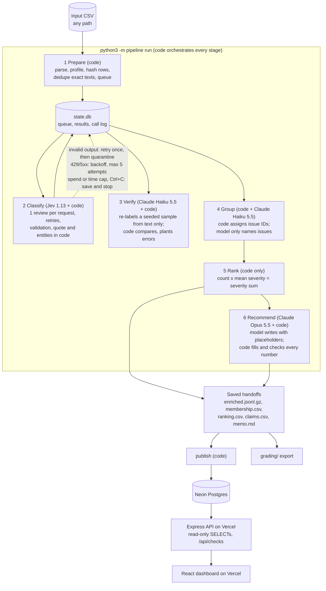

# Spotify review insights: a multi-agent pipeline

Where should Spotify put the next quarter of product effort: access, usability, playback, or billing and support?
This repository turns 100,000 real Google Play reviews into a ranked, evidence-backed answer. A fixed-label
classifier labels every review, an independent model checks a sample, code groups complaints into issues and ranks
them, and a model writes a decision memo whose every number is inserted and checked by code. The results are stored
in Postgres and served by a deployed dashboard.

| | |
|---|---|
| **Live dashboard** | https://spotify-review-insights-rho.vercel.app (public, no sign-in) |
| **Decision memo** | [runs/final_100k/memo.md](runs/final_100k/memo.md) |
| **Grading export** | [grading/](grading/) (passes `check_submission.py` with no issues) |
| **Cost and runtime** | [cost/README.md](cost/README.md) · final run: [cost/final_100k/report.md](cost/final_100k/report.md) · pilot: [cost/report.md](cost/report.md) |
| **Interruption and resume recording** | [evals/recovery/interrupt_and_resume_recording.mov](evals/recovery/interrupt_and_resume_recording.mov) (2 minutes) |
| **Golden-set evaluation** | [evals/golden/golden_report.md](evals/golden/golden_report.md) · [error analysis](evals/golden/ERROR_ANALYSIS.md) |

## Results at a glance

All figures are measured from saved outputs of the final run `final_100k` unless marked as estimates.

| | |
|---|---|
| Source file ingested and profiled | 660,622 rows ([runs/full/ingestion_report.json](runs/full/ingestion_report.json)) |
| Reviews in the final run | 100,013 (100,000 sampled by the course's rule, plus the 13 empty-text reviews) |
| Classified | 100,000 of 100,000 nonempty reviews (100%) |
| Quarantined | 13, all `empty_review_text` |
| Pending or failed | 0 |
| Distinct texts sent to the classifier | 78,099 (21,901 reviews reused the labels of an identical text) |
| Enrichment calls | 78,099 succeeded, 0 failed |
| Complaints and cancellations | 46,141, in 39 issues |
| Independent verification | 2,000 texts re-labeled; agreement 89% topic, 92% intent, 85% severity |
| Golden set (50 hand labels) | Classifier agrees with the human on 92% topic, 92% intent, 84% severity (97%, 95%, 97% on the 37 unambiguous cases) |
| API cost | **$5.00** logged, plus an estimated $0.01 of calls made but never logged (see the failure case). The pre-run projection was $5.56 base, $6.85 conservative; the instructor's limit was $10 |
| Wall-clock time | 25 minutes of enrichment at 8 workers; 43 minutes across all cold sessions including verification |
| Warm rerun of the whole run | 0 model calls, 5.2 seconds |
| Recommendation | **Usability** |

## The recommendation

The memo ([runs/final_100k/memo.md](runs/final_100k/memo.md)) recommends **usability** for next quarter. Usability is the
largest of the four areas by complaint volume (11,716 complaints, 25.4% of complaints) and by total severity (28,871).
Its leading issue is `usability.ads`: 5,574 complaints [C005], mean severity 2.192501 [C007], priority score 12,221
[C008]. Billing and support is the closest alternative (8,193 complaints, severity sum 22,922), and its leading issues
are more severe per complaint. Playback (19,768) and access (6,009) follow; access has the highest mean severity (3.95)
but the smallest volume.

The memo says plainly that count and severity point in different directions: usability wins on breadth, not intensity.
It also states that the analysis covers a 100,013-review sample of the 660,622-review file, that the data has no
revenue or churn, and that cancellation language is stated intent.

Every bracketed claim ID is listed in [runs/final_100k/claims.csv](runs/final_100k/claims.csv) and equals the value in
[runs/final_100k/ranking.csv](runs/final_100k/ranking.csv). The model never typed a number: it wrote placeholders, code
filled them from the saved calculations, and code rejected any memo containing a raw digit, an unknown issue or review
ID, or a missing section ([pipeline/memo.py](pipeline/memo.py), [memo_check.json](runs/final_100k/memo_check.json)).

**Human review.** Code checks every number and citation, but not whether the argument holds, so each memo should be read
by a human reviewer before it is used. For this run, the memo was reviewed by Nick.

## How to check this without an API key

```sh
# 1. The course's zero-API checker on the grading export (build the reference against the 100,013-row analysis file)
python3 data/check_submission.py reference --full data/spotify_reviews_18months.csv --analysis data/final_100k.csv --out local-reference.json
python3 data/check_submission.py check --reference local-reference.json --submission grading --out self-check.json

# 2. Regenerate the ranking from saved records and issue membership (no model, no network)
python3 -m pipeline rank --run-id final_100k

# 3. Replay the cost calculator offline, and check its arithmetic properties
python3 cost/calculator.py --measured cost/final_100k
python3 cost/calculator.py --self-test

# 4. Ask the live backend to recompute the ranking from the database and compare it with the saved tables
curl https://spotify-review-insights-rho.vercel.app/api/checks
```

`data/final_100k.csv` is rebuilt from the full source file by `python3 tools/build_final_subset.py`; its SHA-256 is
`b87ca3b10e8ff88d3a4a203f69ae9a9dc8c36fa4ed67ea8e1e3dda4363808842` ([data/final_100k.manifest.json](data/final_100k.manifest.json)).
The checker reported status `pass`, no issues, and a coverage candidate of 1.0 on this export.

## Rubric map

| Category | Criterion | Evidence |
|---|---|---|
| Deliverable quality | Accessible code, setup and artifacts | [Setup](#setup-and-commands), [requirements.txt](requirements.txt), [.env.example](.env.example), [repository layout](#repository-layout); every output is committed under `runs/`, `cost/`, `evals/`, `grading/` |
| | Clear architecture, shared schema and provenance | [Architecture](#architecture), [labels/LABEL_GUIDE.md](labels/LABEL_GUIDE.md), [pipeline/labels.py](pipeline/labels.py); every record carries its `source_sha256` and `label_config`, every call its model, configuration and request ID |
| | Memo numbers linked to correct calculations and source evidence | [claims.csv](runs/final_100k/claims.csv), [memo_check.json](runs/final_100k/memo_check.json), the checker's claim comparison, the dashboard's [Recommendation page](https://spotify-review-insights-rho.vercel.app/#/recommendation) |
| | Coherent recommendation, alternatives and limitations | [memo.md](runs/final_100k/memo.md), [Limitations](#limitations) |
| Testing and evaluation | 50 human labels, per-field comparisons and error analysis | [evals/golden_50_labeled.csv](evals/golden_50_labeled.csv), [golden_report.md](evals/golden/golden_report.md), [golden_results.csv](evals/golden/golden_results.csv), [ERROR_ANALYSIS.md](evals/golden/ERROR_ANALYSIS.md) |
| | Independent verification, planted-error and injection tests | [verify_report.json](runs/final_100k/verify_report.json), [verify_disagreements.csv](runs/final_100k/verify_disagreements.csv), [injection_report.md](evals/injection/injection_report.md), [Evaluation](#evaluation) |
| | Real 100-review cold/warm pilot, offline calculator, retry, spending and recovery controls | [cost/report.md](cost/report.md), [cost/calculator.py](cost/calculator.py), [Cost, runtime and controls](#cost-runtime-and-controls), [tests/](tests/) |
| Working result | Full ingestion, record coverage, successful classification | [runs/full/ingestion_report.json](runs/full/ingestion_report.json), [grading/](grading/), 100,000 of 100,000 classified |
| | Runnable staged program, bounded calls, saved handoffs, demonstrated resume | [pipeline/](pipeline/), [Interruption and resume](#interruption-and-resume), [the recording](evals/recovery/interrupt_and_resume_recording.mov), [checkpoints](runs/final_100k/checkpoints/) |
| | Reproducible baseline ranking, deployed dashboard, grounded AI recommendations | `python3 -m pipeline rank`, [live dashboard](https://spotify-review-insights-rho.vercel.app), [`/api/checks`](https://spotify-review-insights-rho.vercel.app/api/checks) |

## Architecture



| Stage | Who decides | Input | Output | On failure | Stop condition |
|---|---|---|---|---|---|
| 1 Prepare | Code | Any CSV with the six source columns | `state.db`, [ingestion_report.json](runs/final_100k/ingestion_report.json), [quarantine.jsonl](runs/final_100k/quarantine.jsonl) | Malformed CSV stops the run; empty text is quarantined; repeated IDs are rejected and reported | Every row read |
| 2 Classify | Jev answers four fixed-choice questions; code does everything else | Pending distinct texts | `enrichments` rows, call log, checkpoints | Rate limits and server errors: backoff with jitter, up to 5 attempts; invalid output: one retry, then quarantine; 15 failed attempts across sessions: quarantine; bad key: stop | Queue empty, spend cap, time cap, or Ctrl+C. Later stages refuse to run while anything is pending |
| 3 Verify | Haiku 5.5 labels from the text and rubric only; code compares | 2,000 texts chosen by a seeded hash | [verify_report.json](runs/final_100k/verify_report.json), [disagreements](runs/final_100k/verify_disagreements.csv) | Invalid output retried once; two failed batches in a row stop the stage | Sample done or cap |
| 4 Group | Code assigns every complaint to `topic.aspect` by [rules](labels/issues.json); Haiku only writes titles | Completed complaint and cancellation records | [membership.csv](runs/final_100k/membership.csv), [issues.json](runs/final_100k/issues.json) | Without a model name an issue keeps a code-made title; ranking is unaffected | All complaints grouped |
| 5 Rank | Code | Records and membership files | [ranking.csv](runs/final_100k/ranking.csv), [aggregates.csv](runs/final_100k/aggregates.csv), [topic_rollup.csv](runs/final_100k/topic_rollup.csv) | Reports problems such as ungrouped complaints | Always completes |
| 6 Recommend | Opus 5.5 writes; code fills numbers and checks citations | Ranking, priority-area sums, run facts, 3 example quotes per top issue | [memo.md](runs/final_100k/memo.md), [claims.csv](runs/final_100k/claims.csv), [memo_check.json](runs/final_100k/memo_check.json) | A rejected memo is retried once with the reasons | Valid memo, or a rejection is saved |

**Why each model call is needed, and what code does instead.**
- **Classify (Jev):** reading free-text reviews in many styles and languages is language judgment. Jev returns typed answers
  with probabilities, so code never parses prose. Code handles parsing, exact-duplicate reuse, validation, the severity
  consistency rule, the evidence quote (whole text for short reviews; for long ones Jev only picks one of the sentences
  code split out), entity matching against a [lexicon](labels/entities.json) and the needs-review flag.
- **Verify (Haiku 5.5):** an independent second reading needs a different model that has not seen the first labels.
  Code draws the sample, compares, and runs the planted-error test.
- **Group (Haiku 5.5):** only to give each code-defined issue a readable title. Membership is deterministic, so ranking
  never depends on a model.
- **Recommend (Opus 5.5):** weighing alternatives and writing for an executive is the one open-ended task, done once per
  run from aggregates, never from raw data.

The ranking needs no model at all, and all four roles have separate prompts, inputs, outputs and saved evidence:
[prompts/](prompts/).

## Models and settings

| Role | Model (exact ID) | Setting | Configuration ID in the final run |
|---|---|---|---|
| Enrich | `jev-1.13.0` (TypeSafe) | No effort setting; one review per request | `jev-1.13.0+enrich-jev-v2.22642b2a+schema-v1` |
| Verify | `claude-haiku-5-5` | Effort `low`; 10 reviews per request | `claude-haiku-5-5@effort-low+verify-claude-v2.65b2e839+schema-v1` |
| Group | `claude-haiku-5-5` | Effort `low`; up to 20 issues per request | see [issues.json](runs/final_100k/issues.json) |
| Memo | `claude-opus-5-5` | Effort `high` | `claude-opus-5-5@effort-high+memo-claude-v3.c7fa4db7+schema-v1` |

A configuration ID includes a hash of its prompt file, so results are reused only under an unchanged configuration.
Earlier versions of each prompt stay in [prompts/](prompts/) because earlier evidence cites them. Rates with dated
sources are in [cost/rates.csv](cost/rates.csv).

## Data and scope

- **Source:** BwandoWando, [3.4 Million Spotify Google Store Reviews](https://www.kaggle.com/datasets/bwandowando/3-4-million-spotify-google-store-reviews),
  version 2, CC0, as extracted by the course: `spotify_reviews_18months.csv`, 660,622 rows, 97,400,616 bytes, SHA-256
  `1fc85de68a304dd8978b537cfa58793d5f41cbaf417fa32cb53899f83a2fcef6`. Download the course dataset ZIP from the link in the
  assignment and place its files in `data/`. The large CSV and the ZIP are not committed.
- **Ingestion covers the whole file.** The full profile reproduces every figure in the course manifest: 660,622 rows, 0
  repeated IDs, 13 empty texts, 159,701 missing app versions, 484,189 distinct nonempty texts. It is byte-identical to
  `check_submission.py profile`.
- **Classification covers 100,000 reviews,** as the instructor allowed for this assignment to keep costs down. They are
  the 100,000 reviews with the lowest SHA-256(seed:review_id) values, which is the course's own sampling rule, so they
  contain the golden 50, the 100-review pilot, and the 500 and 10,000 development files. They cover all 19 months. The
  13 empty-text reviews were added so that they are quarantined explicitly.

## Labels

The shared topic, intent and severity definitions are in [labels/LABEL_GUIDE.md](labels/LABEL_GUIDE.md), with decision
rules for awkward cases (premium-only controls, boycotts, emoji and non-English text) and worked examples taken from the
development set, never the golden set. Version 2 of the guide added two clarifications found in the 500-review
development run. Every completed record has `review_id`, `source_sha256`, `status`, `topic`, `intent`, `sentiment`,
`severity`, `entities`, `evidence_quote`, `needs_review`, `label_config`, and `cache_source_id` when its labels were
reused from an identical text.

## Evaluation

### Golden set: 50 hand labels

Nick labeled all 50 golden reviews in two passes before any model prediction for them existed
([evals/golden_50_labeled.csv](evals/golden_50_labeled.csv)). The pipeline ran on the unlabeled course file, so the
labels were never a model input, and nothing was changed after seeing the results. Five non-English reviews were read
with a translation tool.

| Agreement with the human label | Classifier, all 50 | Classifier, 37 unambiguous | Verifier, all 50 |
|---|---|---|---|
| Topic | 92% | 97% | 94% |
| Intent | 92% | 95% | 92% |
| Severity, exact | 84% | 97% | 84% |
| Severity, within one level | 98% | 100% | 100% |
| Topic, intent and severity together | 76% | 92% | 78% |
| Sentiment within 0.5 | 92% | 92% | 94% |

- Nine of the classifier's 12 disagreements are on reviews the labeler had already marked ambiguous, and in seven of
  those it chose exactly the alternative the labeler's notes name.
- The three disagreements on clear reviews are a short Tagalog compliment, a one-word Hindi insult, and garbled text.
- One clear error: a review about a painfully loud ad was given severity 5, which the scale reserves for financial,
  privacy or data harm. The record was flagged for review.
- All 50 evidence quotes are exact substrings of their reviews, checked in code.
- Fifty cases are a small diagnostic sample; one case moves a percentage by two points.

Details: [golden_report.md](evals/golden/golden_report.md) (every disagreement), [golden_results.csv](evals/golden/golden_results.csv)
(per case and per field), [ERROR_ANALYSIS.md](evals/golden/ERROR_ANALYSIS.md).

### Independent verification on the final run

Haiku 5.5 re-labeled 2,000 distinct texts drawn by a seeded hash, from the text and rubric only. It agreed with the
classifier on 88.6% of topics, 92.2% of intents and 84.9% of severities; 551 texts differ on at least one field. Every
disagreement is listed in [verify_disagreements.csv](runs/final_100k/verify_disagreements.csv). Agreement between two
models is not accuracy: two versions of Haiku given the same rubric agreed with each other on only 70% of texts, and on
the golden set the verifier was no closer to the human than the classifier (11 versus 12 disagreements of 50). For that
reason no fallback model was added.

`needs_review`, scored as a prediction of disagreement, was flagged on 894 of the 2,000 texts and caught 78% of
disagreements; 48% of flagged texts were disagreements. It is a useful but weak signal.

### Planted errors and injection

- **Planted errors:** on a separate copy of the predictions, five agreeing labels were changed; the comparison caught
  5 of 5 (in `verify_report.json`, `planted_error_test`).
- **Injection:** eight synthetic reviews, seven containing instructions aimed at the model, ran in their own run and are
  excluded from all results ([injection_report.md](evals/injection/injection_report.md)). The classifier resisted 5 of 8
  and the verifier 6 of 8. The classifier was fooled by a fake "SYSTEM:" line and by an instruction to inflate severity;
  both records were flagged for review and both showed up as verifier disagreements. A pattern search over all 484,189
  distinct real texts found 71 matches, and the ones inspected were ordinary phrases such as "rate it as 5".

## Cost, runtime and controls

| Run | Purpose | API cost | Result |
|---|---|---|---|
| [100-review pilot](cost/report.md) | Required cold and warm pilot, all six stages, one worker | $0.13 cold, $0 warm | Basis of the calculator; its first attempt is kept as a failure (below) |
| [500, version 1](cost/refresh_500/report.md) and [10,000](cost/refresh_10k/report.md) | Checkpoints; the 10,000 run measured 1, 2, 4 and 8 workers | $0.23 and $0.78 | 8 workers ran at 6.1 times the speed of one |
| [500, final configuration](cost/refresh_500_final/report.md) | Checked Haiku 5.5 before the final run | $0.27 | Verification 4.5 times cheaper than Haiku 4.5 |
| [Final 100,000](cost/final_100k/report.md) | The final run | $5.00 | Measured against the projection |

The calculator ([cost/calculator.py](cost/calculator.py)) recomputes every cost as billed units times price per unit from
[usage](cost/final_100k/usage.csv) and editable, dated [rates](cost/rates.csv), with no API key. Its self-test confirms
that doubling every rate doubles API spend while measured time does not move, and that changing the projected volume
leaves the measured pilot unchanged. Paid runs are a separate, explicit command.

**Controls, all exercised:**
- **Spending:** every paid session requires `--max-spend-usd`. A shared ledger reserves worst-case cost before each call
  and stops admitting work when the next reservation would exceed the cap. It stopped a memo retry in the
  [500-review final-configuration run](cost/refresh_500_final/report.md).
- **Retries:** exponential backoff with jitter, honoring `retry-after`, up to 5 attempts; invalid output retried once;
  timeouts logged with unknown usage and charged at their reservation as an estimate. One timeout occurred in the
  10,000-review run and was retried successfully.
- **Concurrency:** worker count and a shared request-rate limit; 8 workers and 60 requests per second in the final run.
- **Caching:** exact-text reuse within a configuration, and zero-call warm reruns at every stage.
- **Recovery:** results, statuses and the call log are saved in one transaction per batch; a rerun resumes from the
  queue. See below.

## Interruption and resume

The final run's enrichment took four sessions. The before-and-after evidence uses the third.

| Session | What happened | Texts labeled | Checkpoint |
|---|---|---|---|
| 1 | Ctrl+C crashed the program (the failure case below) | 2,000 | none written |
| 2 | Stopped with Ctrl+C | 6,250 | 24,509 reviews |
| 3 | **Recorded:** a clean Ctrl+C after 40 seconds | 2,280 | **27,305 reviews** |
| 4 | **Recorded start**, then ran to completion | 67,569 | 100,000 reviews |

[The recording](evals/recovery/interrupt_and_resume_recording.mov) shows session 3 stopping cleanly, the checkpoint
listing, and session 4 reporting the completed texts it would not send again. No review completed before an
interruption was ever sent again afterwards. In [grading/](grading/), enrichment calls from sessions 1 to 3 are labeled
`initial` and session 4 `resume`; each call keeps its real session number ([grading/README.md](grading/README.md)).

## Failures and fixes

**The failure case: an interrupt that crashed the run.** The first Ctrl+C of the final run arrived while a batch was
being saved. The code only handled an interrupt while waiting on requests, so the program exited with a traceback and
wrote no checkpoint. Because each save is a single transaction, nothing was corrupted: 2,000 texts stayed saved and the
batch in progress was rolled back. Those 200 requests had been paid for but were never logged, an estimated $0.01, which
is recorded in [run_log.jsonl](runs/final_100k/run_log.jsonl) and shown as an estimate in the cost report. The fix
([commit "Make Ctrl+C a clean stop"](pipeline/enrich.py)) turns Ctrl+C into a flag: no new requests start, requests in
flight finish, the batch is saved, and a checkpoint is written. A resume also writes a checkpoint of the saved state if
the previous session left none. The same incident exposed a slow database update that cut speed from 55 to 35 texts per
second; the fix restored 57.

**Other failures, all kept on the record:**
- The first pilot rejected every Haiku response because the API answers an alias with a dated model ID; $0.08 was
  wasted. Kept in `runs/pilot_100_attempt1` and the pilot report.
- A memo cited a review ID that was not in its evidence pack; the code check rejected it.
- The first two dashboard deployments failed because Vercel did not install the backend's packages; the backend is now
  bundled into one file.

**An ambiguous case and its handling.** Golden review `723f07de` reports that the app crashed on every launch and then,
in an update, that support fixed it. The guide has no rule for a resolved problem. The labeler chose playback,
complaint, severity 3 and marked it ambiguous, noting severity 4 for the problem as first reported. Both models chose
severity 4. The case counts as a disagreement in the evaluation, and its note explains why both readings are defensible.

## One review traced end to end

Review `d6865cc0-5fe1-4d2e-b6e0-5bebbe5b5b23`, source row 22,017 of the final run:

1. **Source.** "App's the best in everything. No clutter. … Ads are a bit troublesome but other than that it's the best.
   Here's one feature I would really like … A playback speed controller." Four stars, 703 likes, version 8.7.72.546,
   posted 2022-10-10. Row hash `f70a2cb0c9b6…`.
2. **Classification.** Jev call `jev-c405dc10bce142b695eccdcb7b6108be` in session 4: 1,699 input tokens, $0.000071.
   Labels: topic `usability`, intent `complaint` (mixed praise and criticism counts as a complaint), severity 2,
   sentiment 0.5. Jev chose the evidence quote "Ads are a bit troublesome but other than that it's the best." from the
   sentences code split out. Entities from the lexicon: premium, free version, ads, update. Not flagged for review.
3. **Verification.** Not in the 2,000-text verification sample.
4. **Issue.** Assigned by rule to `usability.ads`, because the topic is usability and the entity list contains "ads".
5. **Ranking.** `usability.ads` is rank 2: 5,574 complaints, severity sum 12,221, mean 2.192501, score 12,221. This review
   adds 1 to the count and 2 to the sum.
6. **Memo.** Cited in the memo's Evidence section, next to claims C005 to C008, which `claims.csv` and the checker confirm
   equal the ranking.

The [dashboard's trace page](https://spotify-review-insights-rho.vercel.app/#/reviews/d6865cc0-5fe1-4d2e-b6e0-5bebbe5b5b23)
shows the same chain from the database. This example also shows a limit of the memo: the quote is mild, and a reader
should weigh the counts more than any single example.

## Ranking rules, scope and trend

- **Baseline:** completed complaint and cancellation records, one issue each. `priority_score = complaint_count ×
  mean_severity = severity_sum`, ordered by descending score, then ascending issue ID. Means are exported to six decimals,
  half-up. Praise, requests and unclear records are excluded.
- **Issues:** `topic.aspect`, assigned by [labels/issues.json](labels/issues.json) from the topic, the entity list and text
  patterns. `other.general` (11,967 complaints) is a catch-all for complaints that name no feature; the memo reports it
  but does not treat it as fixable.
- **Trend:** the share of classified reviews that are complaints or cancellations, by quarter. The first quarter starts on
  May 17 and the last ends on Nov 15, so both are partial.

| Quarter | Classified reviews | Complaints and cancellations | Share |
|---|---|---|---|
| 2022 Q2 (from May 17) | 6,984 | 2,200 | 31.5% |
| 2022 Q3 | 13,692 | 4,549 | 33.2% |
| 2022 Q4 | 12,999 | 4,307 | 33.1% |
| 2023 Q1 | 11,593 | 3,876 | 33.4% |
| 2023 Q2 | 12,159 | 4,425 | 36.4% |
| 2023 Q3 | 23,998 | 13,127 | 54.7% |
| 2023 Q4 (to Nov 15) | 18,575 | 13,657 | 73.5% |

The share was steady near a third for a year, then rose sharply in mid-2023, when review volume also roughly doubled.
That pattern fits a wave of complaints after app changes, but these are self-selected reviews, so the rise shows what
reviewers chose to write, not how the whole user base felt.

## Dashboard

https://spotify-review-insights-rho.vercel.app is public and needs no sign-in. It shows overall metrics, the issue
ranking with a page per issue, the AI-generated recommendation with every claim and cited review linked to its evidence,
evaluation and cost results, and a trace page for any review.

- **Database:** Neon Postgres. `python3 -m pipeline publish --run-id final_100k` loads the run's saved files in one
  transaction and refuses to commit if the loaded rows do not reproduce the saved ranking. Schema:
  [dashboard/db/schema.sql](dashboard/db/schema.sql).
- **Backend:** Express on Vercel ([dashboard/backend](dashboard/backend)); parameterized read-only queries. `/api/checks`
  recomputes the ranking from the review rows on each request and compares it with the saved tables, the cited numbers and
  the evidence quotes. All seven checks pass.
- **Front end:** React, Vite and Tailwind ([dashboard/frontend](dashboard/frontend)).
- **Tests:** the backend's tests run the real schema and queries against an in-process Postgres (`npm test` in
  `dashboard/backend`).

## Setup and commands

Requirements: Python 3.12 or later (developed on 3.14); Node 20 or later for the dashboard.

```sh
python3 -m venv .venv && .venv/bin/pip install -r requirements.txt
cp .env.example .env          # add TYPESAFE_API_KEY and ANTHROPIC_API_KEY for paid runs, DATABASE_URL for publishing
.venv/bin/python -m unittest discover tests     # 23 offline tests with fake model transports
```

```sh
# No model calls
python3 -m pipeline ingest --input data/spotify_reviews_18months.csv --run-id full
python3 tools/build_final_subset.py
python3 -m pipeline rank --run-id final_100k
python3 -m pipeline export-grading --run-id final_100k --analysis data/final_100k.csv
python3 tools/golden_eval.py --run runs/golden_50

# Paid: every stage for any input CSV. Rerunning the same command resumes; completed reviews are not sent again.
.venv/bin/python -m pipeline run --input data/final_100k.csv --run-id final_100k --max-spend-usd 10 \
  --workers 8 --max-rps 60 --save-every 200 --verify-sample 2000

# Dashboard
.venv/bin/python -m pipeline publish --run-id final_100k
(cd dashboard && npm run install:all && npm run dev)        # local: http://localhost:5173
(cd dashboard && vercel deploy --prod)                      # needs DATABASE_URL set in the Vercel project
```

Keys live only in a local `.env`, which git ignores; `.env.example` is blank.

## Limitations

- The analysis covers 100,013 of 660,622 reviews, chosen by a reproducible hash rule, not the whole corpus.
- Reviews are self-selected, public and historical, with no revenue, plan tier or confirmed churn. Cancellation language is
  stated intent.
- Labels come from an automated classifier. It agrees with a human on 76% of golden reviews for topic, intent and severity
  together, is weaker on non-English and garbled text, and can be swayed by text that argues for its own label.
- `needs_review` is a weak signal, and the largest issue is a catch-all of unspecific complaints.
- Costs are computed from the usage each API reported. They have not been reconciled with the TypeSafe and Anthropic
  billing dashboards.
- The evidence quotes in the memo are representative examples chosen by likes, not a statistical sample.

## Design notes

- **Jev with Haiku and Opus** follows the course's suggested route and the instructor's advice to combine a decision model
  with a small model. A batched small model might enrich more cheaply than Jev's one-review requests; that was estimated
  but not tested. OpenAI's Decisions API appeared during the project and was not evaluated.
- **Haiku 5.5 replaced Haiku 4.5** for verification and naming on its release day, after a measured comparison on the same
  200 texts.
- **No fallback model:** the golden set gave no evidence that routing hard texts to the verifier model would be more
  accurate.

## Repository layout

| Path | Contents |
|---|---|
| [pipeline/](pipeline/) | The staged program: ingest, enrich, verify, group, rank, memo, publish, export |
| [prompts/](prompts/), [labels/](labels/) | Role prompts, label guide, entity lexicon, issue rules |
| [runs/](runs/) | Saved outputs of every run; `final_100k` is the final run (`state.db` files are not committed) |
| [grading/](grading/) | Standardized export for the course checker |
| [cost/](cost/) | Calculator, rates, assumptions, and the pilot and checkpoint reports |
| [evals/](evals/) | Golden labels and evaluation, injection test, recovery recording |
| [dashboard/](dashboard/) | Database schema, backend, front end, Vercel configuration |
| [tools/](tools/) | Labeling page, subset builder, golden evaluation, injection report |
| [tests/](tests/) | Offline tests for the pipeline |
| [data/](data/) | Course dataset files (place the full CSV here) |
